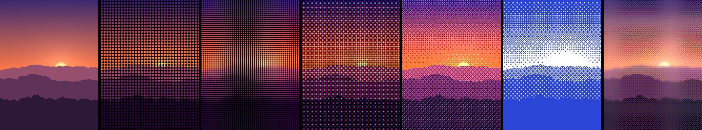
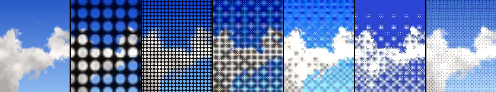
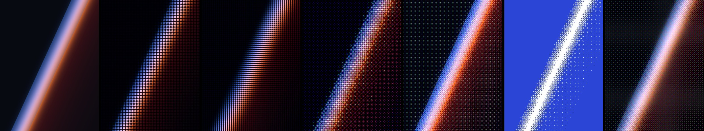

# dotfx

A Claude skill that turns any picture into LED dots, halftone, dither, duotone or pixel art.





Original, then `led`, `soft-led`, `dither`, `fine-dither`, `duotone`, `pixel`.

## Use it with Claude

**claude.ai / Claude app:** download [`dotfx-skill.zip`](dotfx-skill.zip) and upload it in your skills settings. Then send Claude a photo and ask for an LED, dither or pixel look.

**Claude Code:**

```bash
git clone https://github.com/ThibaudFrancony/dotfx
cp -r dotfx/skills/dotfx ~/.claude/skills/
```

## Use it without Claude

```bash
pip install pillow numpy
python skills/dotfx/scripts/dotfx.py photo.jpg                     # all presets
python skills/dotfx/scripts/dotfx.py photo.jpg --preset led --cell 20
python skills/dotfx/scripts/dotfx.py photo.jpg --preset duotone --duo "#C2185B" "#FFF3E0"
```

Every setting can be overridden: `--cell`, `--shape circle|square|line`, `--dot`, `--bg black|white|soft|#hex`, `--blur`, `--levels`, `--bayer 2|4|8`, `--bright`, `--contrast`, `--sat`, `--glow`, `--duo DARK LIGHT`, `--width`.

## Web version

[`web/index.html`](web/index.html) does the same in the browser, with presets and sliders. Open it locally or host it anywhere; nothing leaves your device.

## License

MIT
